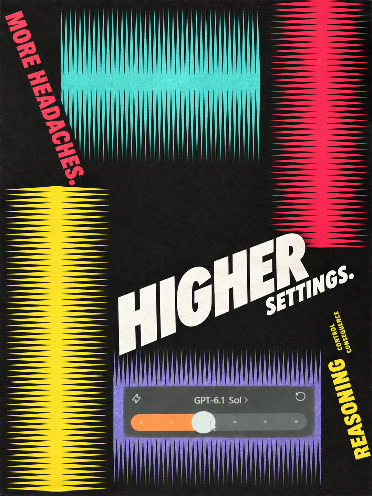

# 阿苏 · 抖音海报封面

**一张图片 + 一段文案 → 一张有海报排版依据的抖音封面。**

`douyin-reference-cover` 是一个 Codex Skill：自动从随包的 **170 张书籍海报参考图**中选一张，将用户图片与该参考一起用于图生图，默认制作全英文封面，并检查文案、整体参考贴近程度和抖音主页裁切。当前版本 **0.3.1**。

## 实际封面案例（0.3.1）

沿用0.3.0的独立执行流程，新增三组实际图生图案例；均为单张1080×1440 JPG。用户在本轮实际使用后认可Skill效果并确认更新到Git。

| 开的越高，越多烦恼 | 加点广告 | 机关算尽不如灵机一动 |
| --- | --- | --- |
| [参考 REF-068](assets/posters/ref-068.jpg) | [参考 REF-006](assets/posters/ref-006.jpg) | [参考 REF-050](assets/posters/ref-050.jpg) |
|  |  |  |

这些实例保留各自主参考的构图及辅助层级。封面新增排字用英文；作为摄影素材的原始界面标签保留原语言，不为英文排版重造界面。该约定已写入Skill入口与生成任务卡。

## 历史图像示例（0.2.0）

输入：一张面条照片，以及「吃面条得用筷子，用AI得靠脑子。」

最终英文：**Noodles need chopsticks. / AI needs brains.**

沿用REF-021的灰调摄影、偏左主体与右侧留白、底部蓝紫/黄两级横向排字，以及从主体转折处引出的细线。

| 本次海报参考 REF-021 | 成品在主页中的裁切预览 |
| --- | --- |
|  |  |

[下载示例上传封面：1080×1920 JPG](examples/noodle-ai-upload.jpg)

## 使用

将整个仓库放到 Codex 的 `skills/douyin-reference-cover` 目录，保留 `SKILL.md`、`assets`、`references`、`scripts` 和 `agents` 的相对位置。Windows 常用位置为 `%USERPROFILE%/.codex/skills/douyin-reference-cover`。已安装旧版本时先备份，更新这个 Skill 的文件。

提供图片并说：

> 使用 $douyin-reference-cover。标题：吃面条得用筷子，用AI得靠脑子。

Skill 自动选参考，直接制作并只交付一张1080×1440、3:4的JPG封面。过程稿和内部检查图不逐轮展示，不额外提供9:16母版、预览图或格式副本。只要求修订Skill时不生成图片。也可以指定「这次用 REF-021」。无需每次先选风格或填写设计问卷。

封面默认全英文：中文输入忠实翻译，确定的英文逐字使用，允许调整断行和文字层级；用户明确指定其他语言时按指定。参考海报中的品牌、人物和外文不自动带入成品。范围限定为这套参考库驱动的封面制作及修改。

## 独立执行的生产流程

无需历史聊天。入口中的默认语言、单张尺寸、内容边界与工作步骤均可独立使用：

1. 从内置图库检索并查看真实参考，按主体、文字量和层级密度选图。
2. 列出参考的完整元素清单，涵盖细字、编号、色带文字、边框、表格和图形关系。
3. 将每项的内容来源、位置尺度与处理方法写成映射表，确定所有上图文字，逐格列出表格。
4. 将两张实际输入图、整体约束、全部元素与文字清单交给图生图工具。
5. 用实际成品逐项检查整体审美、所有元素与文字；缺失和漂移退回局部修正。
6. 只交付一个通过检查的3:4 JPG。

辅助内容可按原意概括，数值需有依据；参考没有的细节不强加，不能把一个示例的02、黑框或配色套到其他海报。详见 [内容适配](references/content-mapping.md)、[生成任务卡](references/generation.md)与[实图验收](references/reference-fidelity.md)。

## 单张封面尺寸

默认只制作一张 **1080×1440、3:4、sRGB JPG**。直接在这个比例里排版，文案与主体留边，避开左下播放量区域。内部检查可读性，不额外交付裁切预览、缩略图、PNG副本或9:16母版。

这是当前用户指定的工作默认值，以本次实际发布器框形为准。规则详见 [platform-framing.md](references/platform-framing.md)。

上方是0.2.0历史案例：右侧为当时保存的3:4预览，原上传文件为9:16。仅修订Skill不会重新制作、裁切或替换这些历史图片；今后交付遵循本节单张3:4规则。

## 参考图库

所有 **170 张 JPG 与6张总览图都已直接包含在仓库**，没有外部下载链接依赖。参考副本最长边1600像素，来源是用户提供的书籍拍摄照片，经透视、裁切、白平衡与曲面校正后整理。

| 总览 | 范围 |
| --- | --- |
| [第1页](assets/contact-sheets/sheet-01.jpg) | REF-001～030 |
| [第2页](assets/contact-sheets/sheet-02.jpg) | REF-031～060 |
| [第3页](assets/contact-sheets/sheet-03.jpg) | REF-061～090 |
| [第4页](assets/contact-sheets/sheet-04.jpg) | REF-091～120 |
| [第5页](assets/contact-sheets/sheet-05.jpg) | REF-121～150 |
| [第6页](assets/contact-sheets/sheet-06.jpg) | REF-151～170 |

[浏览全部单图](assets/posters) · [索引与标签](references/catalog.json) · [选图说明](references/library-guide.md)

## 工具与依赖

生成需要宿主提供可接收参考图片的图像生成/编辑工具，优先使用 Codex 内置图像工具。仅安装 Skill 不会自动提供生图服务；费用随实际宿主工具计费。

可选检索脚本仅需 Python 标准库；裁切检查脚本另需 Pillow：

```text
python scripts/library.py --id 21
python scripts/library.py --tags photographic typography --limit 8
python scripts/check_framing.py cover.png --out-dir framing-check
```

裁切脚本仅检查尺寸、裁切和可选标题框位置，不负责生成图像，也不能证明文字正确或通过平台审核。

## 素材来源与权利

参考图为用户提供的书籍海报翻拍整理，用于观察构图、字体层级与视觉组织。原海报、字体、品牌等权利归各自权利人；仓库公开展示不意味着对原作品授予再许可。

## 验证记录

- Skill 结构校验通过；170张单图、6张总览图均完成解码与相对路径检查。
- 检索脚本的编号、标签、总览与无效编号处理通过。
- 裁切脚本验证了正常构图、标题出框、左下覆盖和非默认尺寸的识别。
- 0.2.0历史案例已核对英文文案、参考视觉关系和当时的尺寸适配。0.2.1仅修订规则和尺寸检查，不重新生成图片；未执行抖音线上发布。

### 0.3.0 无上下文前置演练

每组独立执行仅接收Skill路径、原始图片、简短文案与可选参考编号，不提供历史对话或期望答案。只产出内部元素映射、完整文字清单及生图提示词，不调用生图或修改图片。

| 场景 | 结果 |
| --- | --- |
| 指定REF-162；“好工具放大判断，不替代判断。” | 完成15项元素映射，包括小字、带字红条、醒目标识和六格资料表；无数字依据时用相关短词替代周年数字，无须逐项提醒 |
| 自动选图；“先把问题想清楚，再让AI动手。” | 自行查看候选后选定REF-006，完成该参考的摄影、题签、数字台座和极细字等层级，没有强加上一参考的表格 |
| 指定纯文字REF-151；精确英文“Less clicking. More thinking.” | 自行确定真实照片在局部负空间的半调融合位置，保留四列小字和点阵字层级，标题大小写及标点不变，没有额外表格或数字 |

首次演练发现了纯文字参考没有照片槽位时的优先关系冲突，以及用语法分句数凑数字的问题；补充通用处理规则后，以不携带先前演练记录的新执行复测，均无前置阻碍。

另完成170张参考图与6张总览解码、内部链接检查及迁移到新目录后的检索验证。**上述证明流程和任务卡可独立执行，不等于0.3.0新生成封面的实图质量已验证**；实际生成仍须按随包的逐项实图验收执行。本轮未生图，未更改历史图片。

### 0.3.1 实图与交付检查

- 三个实际成品的主文案、参考图形/排字层级及界面关键字段完成目视核对；不再仅有文字任务卡演练证据。
- 三个上传到示例目录的文件均读取验证为1080×1440、RGB、JPG，并逐文件校验与本轮交付成品一致。
- 沿用已有170张参考图库和可移植的相对路径。核心生产流程保持0.3.0，补充原始界面文字与新增封面排字的边界说明。
- 用户认可的是本轮Skill实际效果；未实际发布到抖音，不宣称平台审核、线上裁切或所有未来生成均已验证。
