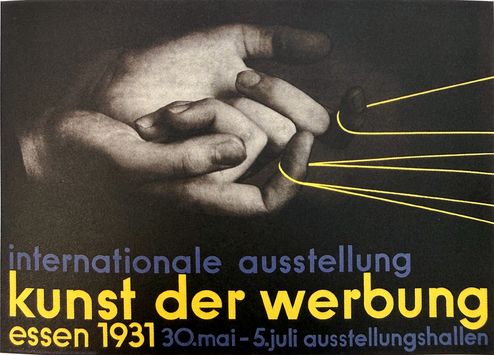
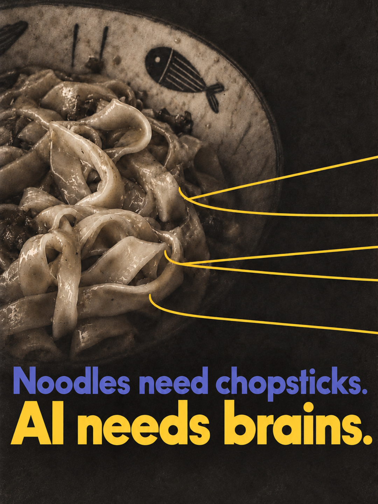

# 阿苏 · 抖音海报封面

**一张图片 + 一段文案 → 一张有海报排版依据的抖音封面。**

`douyin-reference-cover` 是一个 Codex Skill：自动从随包的 **170 张书籍海报参考图**中选一张，将用户图片与该参考一起用于图生图，默认制作全英文封面，并检查文案、整体参考贴近程度和抖音主页裁切。当前版本 **0.2.2**。

## 实际示例

输入：一张面条照片，以及「吃面条得用筷子，用AI得靠脑子。」

最终英文：**Noodles need chopsticks. / AI needs brains.**

沿用REF-021的灰调摄影、偏左主体与右侧留白、底部蓝紫/黄两级横向排字，以及从主体转折处引出的细线。

| 本次海报参考 REF-021 | 成品在主页中的裁切预览 |
| --- | --- |
|  |  |

[下载示例上传封面：1080×1920 JPG](examples/noodle-ai-upload.jpg)

## 使用

将整个仓库放到 Codex 的 `skills/douyin-reference-cover` 目录，保留 `SKILL.md`、`assets`、`references`、`scripts` 和 `agents` 的相对位置。Windows 常用位置为 `%USERPROFILE%/.codex/skills/douyin-reference-cover`。已安装旧版本时先备份，更新这个 Skill 的文件。

提供图片并说：

> 使用 $douyin-reference-cover。标题：吃面条得用筷子，用AI得靠脑子。

Skill 自动选参考，直接制作并只交付一张1080×1440、3:4的JPG封面。过程稿和内部检查图不逐轮展示，不额外提供9:16母版、预览图或格式副本。只要求修订Skill时不生成图片。也可以指定「这次用 REF-021」。无需每次先选风格或填写设计问卷。

封面默认全英文：中文输入忠实翻译，确定的英文逐字使用，允许调整断行和文字层级；用户明确指定其他语言时按指定。参考海报中的品牌、人物和外文不自动带入成品。范围限定为这套参考库驱动的封面制作及修改。

## 参考的贴近程度

默认以选定海报为版式与整体审美依据，替换主体和文案。逐项对照构图、明暗氛围、排字、色彩面积、图形与主体关系及整体美感；只出现同色和类似装饰不能通过验收。适配画幅时保留这些关系，不自动套用通用短视频大字模板。详见 [参考贴近与审美验收](references/reference-fidelity.md)。

小字、色带内的文字、大数字及黑框表格同样需要按内容适配，不能自动删掉。辅助文案可忠实概括原意，数字要有内容依据，表格可整理已有对应关系；已确定的主标题保持原文。

## 单张封面尺寸

按用户2026-10-28提供的实际封面编辑器白框，默认只制作一张 **1080×1440、3:4、sRGB JPG**。直接在这个比例里排版，文案与主体留边，避开左下播放量区域。内部检查可读性，不额外交付裁切预览、缩略图、PNG副本或9:16母版。

这是当前用户指定的工作默认值，以本次实际发布器框形为准。规则详见 [platform-framing.md](references/platform-framing.md)。

上方是0.2.0历史案例：右侧为当时保存的3:4预览，原上传文件为9:16。仅修订Skill不会重新制作、裁切或替换这些历史图片；今后交付遵循本节单张3:4规则。

## 参考图库

所有 **170 张 JPG 与6张总览图都已直接包含在仓库**，没有外部下载链接依赖。参考副本最长边1600像素，来源是用户提供的书籍拍摄照片，经透视、裁切、白平衡与曲面校正后整理。

| 总览 | 范围 |
| --- | --- |
| [第1页](assets/contact-sheets/sheet-01.jpg) | REF-001～030 |
| [第2页](assets/contact-sheets/sheet-02.jpg) | REF-031～060 |
| [第3页](assets/contact-sheets/sheet-03.jpg) | REF-061～090 |
| [第4页](assets/contact-sheets/sheet-04.jpg) | REF-091～120 |
| [第5页](assets/contact-sheets/sheet-05.jpg) | REF-121～150 |
| [第6页](assets/contact-sheets/sheet-06.jpg) | REF-151～170 |

[浏览全部单图](assets/posters) · [索引与标签](references/catalog.json) · [选图说明](references/library-guide.md)

## 工具与依赖

生成需要宿主提供可接收参考图片的图像生成/编辑工具，优先使用 Codex 内置图像工具。仅安装 Skill 不会自动提供生图服务；费用随实际宿主工具计费。

可选检索脚本仅需 Python 标准库；裁切检查脚本另需 Pillow：

```text
python scripts/library.py --id 21
python scripts/library.py --tags photographic typography --limit 8
python scripts/check_framing.py cover.png --out-dir framing-check
```

裁切脚本仅检查尺寸、裁切和可选标题框位置，不负责生成图像，也不能证明文字正确或通过平台审核。

## 素材来源与权利

参考图为用户提供的书籍海报翻拍整理，用于观察构图、字体层级与视觉组织。原海报、字体、品牌等权利归各自权利人；仓库公开展示不意味着对原作品授予再许可。

## 验证记录

- Skill 结构校验通过；170张单图、6张总览图均完成解码与相对路径检查。
- 检索脚本的编号、标签、总览与无效编号处理通过。
- 裁切脚本验证了正常构图、标题出框、左下覆盖和非默认尺寸的识别。
- 0.2.0历史案例已核对英文文案、参考视觉关系和当时的尺寸适配。0.2.1仅修订规则和尺寸检查，不重新生成图片；未执行抖音线上发布。
